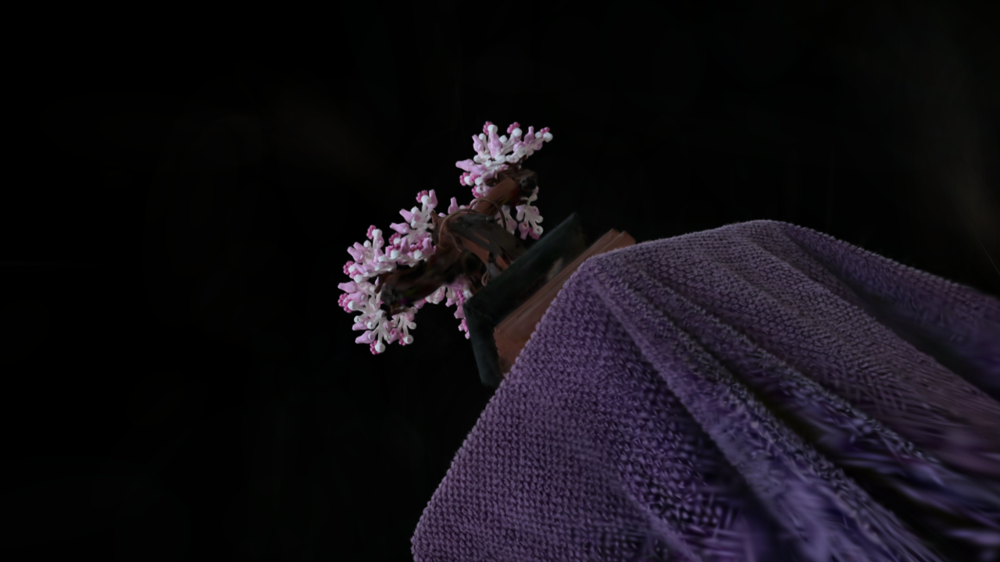

# WebGPU Gaussian Splat Viewer

**Qingyao Tian** · University of Pennsylvania, CIS 565: GPU Programming and Architecture · Project 5

A WebGPU viewer that reconstructs pretrained 3D Gaussian scenes through anisotropic splats, view-dependent color, and depth-sorted alpha blending. The viewer includes a point-cloud comparison, rendering diagnostics, and a selectable half-precision preprocessing path.



*Bonsai scene, 272,956 input Gaussians, 1280 × 720, FP16 / Mixed preprocessing.*

[45-second feature demo](docs/media/feature-demo.webm) · [Point-cloud comparison](docs/images/renderer-comparison.png) · [Performance figures](docs/images/) · [Precision comparison](docs/images/precision-comparison.png)

The demo shows point-cloud and splat rendering, debug views, SH degree and scale controls, FP32/FP16 switching, camera presets, culling, and depth sorting.

## Implemented features

- **Point-cloud rendering:** model/view/projection transforms display Gaussian centers as a geometric reference.
- **Gaussian preprocessing:** decode packed scene attributes, reconstruct scale and opacity, form 3D covariance from rotation and scale, and project it to a screen-space ellipse with its conic and quad bounds.
- **View-dependent appearance:** evaluate spherical harmonics through degree 3 and apply exponential Gaussian opacity falloff during rasterization.
- **GPU visibility and ordering:** frustum culling and atomic compaction feed the supplied GPU radix sorter; back-to-front order and a GPU-written instance count drive indirect quad drawing.
- **Half-precision preprocessing — extra credit:** native WGSL `f16` arithmetic for SH evaluation and guarded quaternion-to-rotation calculations, with precision-sensitive projection, covariance, and depth calculations in FP32.
- **Interactive inspection:** PLY and camera JSON loading, saved camera selection, Gaussian scale, SH degree, culling/sorting switches, and white-quad, color, size, and pixel-offset views.

## Rendering pipeline

`Load PLY → preprocess and cull → compact visible splats → sort by depth → indirect quad draw → alpha composite`

Preprocessing converts each visible 3D Gaussian into screen-space rendering attributes. The vertex shader expands these into a quad; the fragment shader evaluates the elliptical Gaussian and outputs premultiplied color. Drawing from back to front blends overlapping splats into a continuous image.

The point-cloud view exposes sample locations, while Gaussian rendering adds surface coverage, learned color, and soft overlapping boundaries. See [preprocess.wgsl](src/shaders/preprocess.wgsl), [gaussian.wgsl](src/shaders/gaussian.wgsl), and [gaussian-renderer.ts](src/renderers/gaussian-renderer.ts).

## Half-precision preprocessing

The **FP16 / Mixed** option uses real half-precision arithmetic for bounded SH and rotation operations. Per-Gaussian guards select FP32 for large SH coefficients or strongly anisotropic shapes, preserving accuracy where rounding is more sensitive. The viewer detects `shader-f16` support and automatically selects FP32 on other devices.

Across four Bonsai camera views, mixed precision achieves **63.1–66.3 dB full-image PSNR** relative to FP32. In the overview, all **266,696 retained Gaussians** use half-precision SH, and **218,627** also use half-precision rotation.

A separate six-round comparison measured **2.024 ms for FP32 and 2.045 ms for mixed precision** in the full overview, with preprocessing at **0.223 / 0.225 ms**. Performance is similar on this GPU: most GPU time remains in sorting and rasterization, and both paths already share packed input storage. [Image comparison](docs/images/precision-comparison.png) · [Timing data](docs/data/precision-performance.csv).

## Performance highlights

Measurements use **Chrome 155 on Windows, an RTX 4070 Laptop GPU, and 1280 × 720** output. The basic suite averages five runs per configuration, each with 64 warmup and 192 measured frames. GPU timestamps measure preprocessing through rasterization; point-cloud timing covers its render pass.

| Experiment | Measured result |
| --- | --- |
| Point cloud / Gaussian, full overview | **0.188 / 2.033 ms** |
| Frustum culling off → on, camera 0 | **1.803 → 1.396 ms**, a **22.6%** reduction |
| 25,000 → 272,956 input Gaussians, overview | **0.453 → 2.033 ms** |
| Preprocess workgroups of 32, 64, 128, and 256 | **0.224–0.230 ms** preprocessing |

Culling is most effective in a restricted view: camera 0 reduces the retained set from **270,385 to 94,324**, saving preprocessing and sorting work. In the overview, most splats remain visible, so the effect is small. Increasing Gaussian count adds projection, sorting, and blended pixel work; rasterization accounts for about 60% of the full overview's GPU interval.

Workgroup sizes from 32 to 256 perform similarly in this experiment. Each invocation handles one Gaussian independently, and changing the preprocessing group size leaves sorting and rasterization unchanged. Their larger share of the frame helps explain the small overall variation.

[Basic measurements](docs/data/basic-performance.csv) and [precision measurements](docs/data/precision-performance.csv) include stage timings and repeated-run results. Validation also covers CPU-reference projection and SH evaluation, sort order, indirect counts, edge clipping, and precision fallback. Plots show [workgroup sizes](docs/images/workgroup-performance.png), [culling](docs/images/culling-performance.png), and [Gaussian count](docs/images/count-performance.png); [quality metrics and validation summaries](docs/data/) accompany them.

## Run locally

Requirements: **Node.js, npm, and a WebGPU-capable browser with hardware acceleration**. From the repository root:

```sh
npm ci
npm run dev
```

Open the URL printed by Vite. Download the Bonsai PLY and matching camera JSON from the [course scene files](https://drive.google.com/drive/folders/1Fz0QhyDU12JTsl2e7umGi5iy_V9drrIW?usp=sharing), place them at `public/scenes/bonsai/bonsai.ply` and `public/scenes/bonsai/cameras.json`, and click **Load Bonsai**. The **Gaussian PLY** and **Camera JSON** controls also accept local files directly.

Left-drag to rotate the camera, right-drag to pan, and use the wheel to move forward/backward. The control panel switches renderers, preprocessing precision, display modes, scale, SH degree, and camera presets.

```sh
npm run build
npm run preview
```

The build performs TypeScript checking and produces the viewer in `dist/`. Selected figures and data are in [docs](docs/), with the [measurement protocol](docs/data/measurement-method.json) recorded alongside the results.

For GitHub Pages deployment, enable the repository's Actions workflows and select **Settings → Pages → Source: GitHub Actions**. The included workflow builds and deploys pushes to `main`; the hosted viewer accepts local PLY and camera JSON files through the same controls.

## Credits

Built on the CIS 565 starter, including its scene-loading utilities and GPU radix sorter. Rendering follows [3D Gaussian Splatting for Real-Time Radiance Field Rendering](https://repo-sam.inria.fr/fungraph/3d-gaussian-splatting/) and the [Differential Gaussian Rasterization](https://github.com/graphdeco-inria/diff-gaussian-rasterization) reference. The Bonsai scene is supplied through the course dataset collection. Dependencies include Vite, Tweakpane and its file-import plugin, wgpu-matrix, loaders.gl, and `@petamoriken/float16`.
